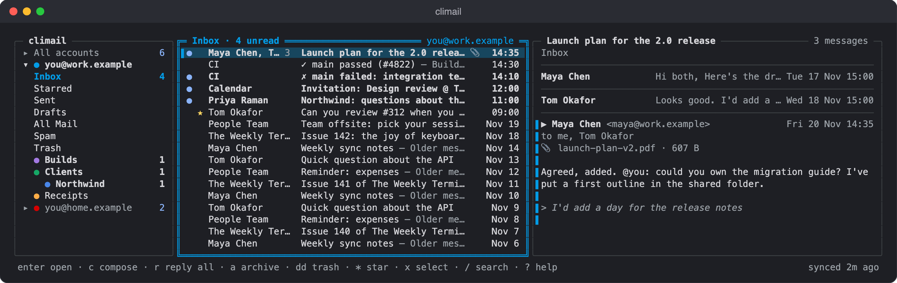
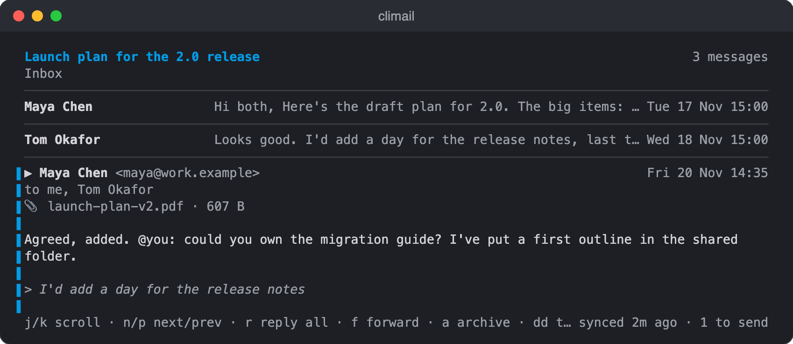

# climail

A fast terminal client for Gmail: a keyboard-driven TUI for reading and triaging mail across several Google
accounts, and a Unix-friendly CLI for scripts. Mail is cached locally, so reading is instant and works offline;
changes sync in the background.





```
$ climail list -n 3
● 14:35       Maya Chen, Tom Okafor (…  Launch plan for the 2.0 release  [t-launch]
  14:30       CI                        ✓ main passed (#4822)  [t-ci2]
● 14:10       CI                        ✗ main failed: integration tests (#4821)  [t-ci]
```

## Install

Needs Go 1.26 or newer. Linux and macOS are supported.

```bash
go install github.com/jabiOP/climail@latest
```

From a clone of the repository, `make install` builds and installs it, and restarts the daemon (if you installed
one) so it runs the new version. To update: `git pull && make install`.

Go installs programs in `~/go/bin` (or `$GOBIN`); if `climail` isn't found afterwards, add that folder to your PATH:
`echo 'export PATH="$HOME/go/bin:$PATH"' >> ~/.zshrc` (or `~/.bashrc`), then open a new terminal.

To try it without a Google account, `climail demo` opens the TUI on a made-up mailbox with two accounts.

## First run

1. Create your Google OAuth client (about 10 minutes, once): [docs/setup-google-cloud.md](docs/setup-google-cloud.md).
2. `climail auth setup ~/Downloads/client_secret_*.json`
3. `climail auth login` (opens your browser, then downloads your recent mail). Repeat to add more accounts.
4. `climail` opens your mail; `?` shows the keys.

To keep mail fresh, and changes flowing to Gmail, even when climail isn't open:

```bash
climail daemon install
```

It writes a systemd user service (Linux) or a launchd agent (macOS) and prints the command that starts it.

## Documentation

- [docs/cli.md](docs/cli.md): every TUI key, writing mail, every command and the configuration.
- [docs/scripting.md](docs/scripting.md): recipes for status bars, new-mail notifications, cleanups, fzf and jq.
- [docs/privacy.md](docs/privacy.md): the privacy policy.

## Privacy

Your mail stays on your computer (`~/.local/share/climail/`) and in your Google account; climail talks to nothing
else. Your login tokens are kept in the system keyring (or a private file in that folder where there is none), and
the OAuth client is your own.

## Development

```bash
make install   # go install ., then restart the daemon (if installed) on the new version
make test      # go test -race ./...
make lint      # gofmt check and go vet
make vuln      # govulncheck: the code and its dependencies (needs the network)
```
